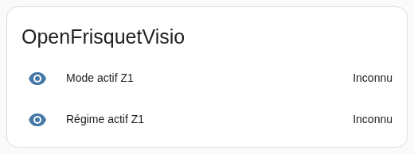
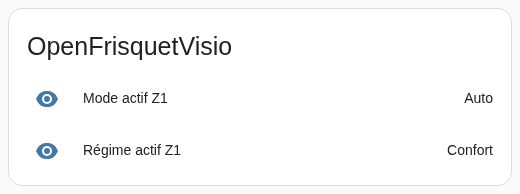

# Mode des zones Connect après redémarrage

Le correctif rétablit le mode et le régime des zones Connect dans Home Assistant
à partir de la réponse radio ordinaire de la chaudière.

## Avant

Après le redémarrage du pont, le thermostat, le mode actif et le régime actif
pouvaient rester inconnus pendant des heures. Deux incidents enregistrés ont
duré environ 5 h 12 et 10 h 02. Ces durées ne sont pas des délais fixes.
Les [intervalles historiques](zone-state-recovery/observed-intervals.json)
contiennent uniquement les durées arrondies, sans identifiants personnels.

La réponse ordinaire de la chaudière contenait déjà le mode. Le code la
recevait mais ignorait ce champ pour les zones dont la source était Connect.
Le mode publié attendait alors un échange de configuration distinct (A154).

## Après

Le pont décode maintenant le mode de la zone dans cette réponse. Les lignes
« Mode actif Z1 » et « Régime actif Z1 » retrouvent leur valeur ; le thermostat
retrouve également son mode.
Le temps de récupération dépend de la prochaine réception valide.

Ces images sont des extraits reconstitués de la carte Home Assistant,
limités aux deux lignes concernées.
Le [HTML source](zone-state-recovery/preview.html) est rendu dans Chromium
à 520 × 194 avec `?state=before` ou `?state=after`.

Les observations radio, l'essai sur appareil, les tests et leurs limites sont
décrits dans le [rapport de validation](zone-acquisition/README.md).
